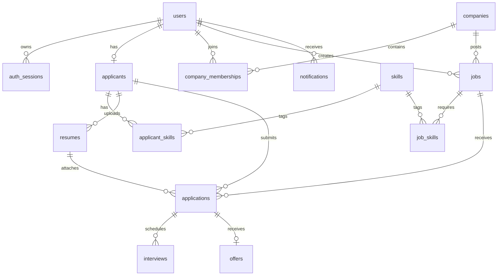

# Cơ sở dữ liệu Job Portal rút gọn

Phiên bản này dành cho mục tiêu học xây dựng API nghiệp vụ. Schema có **14 bảng**, đủ cho luồng đăng nhập, quản lý công ty, đăng job, ứng tuyển, phỏng vấn, offer, thông báo và gợi ý việc làm cơ bản.

## 1. Nguyên tắc tối ưu

- Giữ `company_memberships` vì một công ty có thể có nhiều recruiter.
- Gộp học vấn và kinh nghiệm vào JSONB của `applicants`.
- Lưu location/category trực tiếp trong `companies` và `jobs`.
- Chỉ lưu trạng thái hiện tại; chưa dùng bảng lịch sử riêng.
- AI đọc dữ liệu hiện có và gọi provider theo request, chưa cần bảng cache/rate-limit riêng.

## 2. Sơ đồ quan hệ

## 3. Danh sách 14 bảng

| Bảng | Mục đích | Trường chính |
|---|---|---|
| `users` | Tài khoản và vai trò | email, password_hash, full_name, role, status |
| `auth_sessions` | Refresh-token session | user_id, refresh_token_hash, expires_at, revoked_at |
| `companies` | Hồ sơ công ty | name, industry, location, verification_status, status |
| `company_memberships` | Recruiter thuộc công ty | company_id, user_id, membership_role |
| `applicants` | Hồ sơ ứng viên | user_id, headline, location, education JSONB, experience JSONB |
| `skills` | Danh mục kỹ năng | name |
| `applicant_skills` | Kỹ năng ứng viên | applicant_id, skill_id |
| `jobs` | Tin tuyển dụng | company_id, title, location, category, salary, deadline, status |
| `job_skills` | Kỹ năng job yêu cầu | job_id, skill_id |
| `resumes` | Metadata file CV | applicant_id, storage_key, mime_type, size_bytes |
| `applications` | Đơn ứng tuyển | job_id, applicant_id, resume_id, status, recruiter_note |
| `interviews` | Vòng phỏng vấn | application_id, round_number, scheduled_at, status, result |
| `offers` | Thư mời nhận việc | application_id, salary, response_deadline, status |
| `notifications` | Thông báo trong ứng dụng | user_id, title, body, resource_type, resource_id |

## 4. Chi tiết cột, kiểu dữ liệu và khóa

Phần này mô tả schema PostgreSQL được tạo bởi migration
`src/backend/migrations/versions/0c4b8405e072_create_compact_job_portal_schema.py`.

Quy ước:

- **PK**: khóa chính; **FK**: khóa ngoại; **UQ**: ràng buộc duy nhất.
- `NOT NULL` là bắt buộc; `NULL` là có thể để trống.
- `TIMESTAMPTZ` là `timestamp with time zone`; `NUMERIC(14,2)` phù hợp để lưu tiền.
- Các cột UUID không có default tại PostgreSQL; ứng dụng tạo UUID trước khi ghi dữ liệu.

### 4.1. `users`

| Cột | Kiểu dữ liệu | Null/default | Khóa và ràng buộc |
|---|---|---|---|
| `id` | UUID | NOT NULL | PK |
| `email` | VARCHAR(254) | NOT NULL | UQ |
| `password_hash` | TEXT | NOT NULL | |
| `full_name` | VARCHAR(150) | NOT NULL | |
| `phone` | VARCHAR(32) | NULL | |
| `role` | VARCHAR(16) | NOT NULL | `APPLICANT`, `RECRUITER`, `ADMIN` |
| `status` | VARCHAR(16) | NOT NULL, default `ACTIVE` | `ACTIVE`, `SUSPENDED` |
| `created_at` | TIMESTAMPTZ | NOT NULL, default `now()` | |
| `updated_at` | TIMESTAMPTZ | NOT NULL, default `now()` | |

### 4.2. `auth_sessions`

| Cột | Kiểu dữ liệu | Null/default | Khóa và ràng buộc |
|---|---|---|---|
| `id` | UUID | NOT NULL | PK |
| `user_id` | UUID | NOT NULL | FK -> `users.id` |
| `refresh_token_hash` | VARCHAR(64) | NOT NULL | UQ |
| `expires_at` | TIMESTAMPTZ | NOT NULL | |
| `revoked_at` | TIMESTAMPTZ | NULL | |
| `created_at` | TIMESTAMPTZ | NOT NULL, default `now()` | |

### 4.3. `companies`

| Cột | Kiểu dữ liệu | Null/default | Khóa và ràng buộc |
|---|---|---|---|
| `id` | UUID | NOT NULL | PK |
| `name` | VARCHAR(200) | NOT NULL | |
| `description` | TEXT | NULL | |
| `industry` | VARCHAR(120) | NOT NULL | |
| `location` | VARCHAR(150) | NOT NULL | |
| `website_url` | VARCHAR(500) | NULL | |
| `verification_status` | VARCHAR(16) | NOT NULL, default `PENDING` | `PENDING`, `VERIFIED`, `REJECTED` |
| `status` | VARCHAR(16) | NOT NULL, default `ACTIVE` | `ACTIVE`, `SUSPENDED` |
| `created_at` | TIMESTAMPTZ | NOT NULL, default `now()` | |
| `updated_at` | TIMESTAMPTZ | NOT NULL, default `now()` | |

### 4.4. `company_memberships`

| Cột | Kiểu dữ liệu | Null/default | Khóa và ràng buộc |
|---|---|---|---|
| `id` | UUID | NOT NULL | PK |
| `company_id` | UUID | NOT NULL | FK -> `companies.id`; UQ cùng `user_id` |
| `user_id` | UUID | NOT NULL | FK -> `users.id`; UQ; UQ cùng `company_id` |
| `membership_role` | VARCHAR(8) | NOT NULL, default `MEMBER` | `OWNER`, `MEMBER` |
| `created_at` | TIMESTAMPTZ | NOT NULL, default `now()` | |

`user_id` là UQ nên một recruiter chỉ thuộc tối đa một công ty. Cặp
(`company_id`, `user_id`) cũng là UQ để ngăn membership trùng lặp.

### 4.5. `applicants`

| Cột | Kiểu dữ liệu | Null/default | Khóa và ràng buộc |
|---|---|---|---|
| `id` | UUID | NOT NULL | PK |
| `user_id` | UUID | NOT NULL | FK -> `users.id`; UQ |
| `headline` | VARCHAR(200) | NULL | |
| `summary` | TEXT | NULL | |
| `location` | VARCHAR(150) | NULL | |
| `education` | JSONB | NOT NULL, default `[]` | |
| `experience` | JSONB | NOT NULL, default `[]` | |
| `desired_salary` | NUMERIC(14,2) | NULL | Phải >= 0 nếu có giá trị |
| `created_at` | TIMESTAMPTZ | NOT NULL, default `now()` | |
| `updated_at` | TIMESTAMPTZ | NOT NULL, default `now()` | |

### 4.6. `skills`

| Cột | Kiểu dữ liệu | Null/default | Khóa và ràng buộc |
|---|---|---|---|
| `id` | UUID | NOT NULL | PK |
| `name` | VARCHAR(100) | NOT NULL | UQ |
| `created_at` | TIMESTAMPTZ | NOT NULL, default `now()` | |

### 4.7. `applicant_skills`

| Cột | Kiểu dữ liệu | Null/default | Khóa và ràng buộc |
|---|---|---|---|
| `applicant_id` | UUID | NOT NULL | PK ghép; FK -> `applicants.id` |
| `skill_id` | UUID | NOT NULL | PK ghép; FK -> `skills.id` |

PK ghép là (`applicant_id`, `skill_id`).

### 4.8. `jobs`

| Cột | Kiểu dữ liệu | Null/default | Khóa và ràng buộc |
|---|---|---|---|
| `id` | UUID | NOT NULL | PK |
| `company_id` | UUID | NOT NULL | FK -> `companies.id`; index `ix_jobs_company` |
| `created_by` | UUID | NOT NULL | FK -> `users.id` |
| `title` | VARCHAR(200) | NOT NULL | |
| `description` | TEXT | NOT NULL | |
| `requirements` | TEXT | NULL | |
| `location` | VARCHAR(150) | NOT NULL | |
| `category` | VARCHAR(120) | NOT NULL | |
| `employment_type` | VARCHAR(16) | NOT NULL | `FULL_TIME`, `PART_TIME`, `INTERNSHIP`, `CONTRACT` |
| `salary_min` | NUMERIC(14,2) | NULL | Phải >= 0 nếu có giá trị |
| `salary_max` | NUMERIC(14,2) | NULL | Phải >= `salary_min` nếu có giá trị |
| `deadline` | TIMESTAMPTZ | NOT NULL | Index ghép với `status` |
| `status` | VARCHAR(16) | NOT NULL, default `DRAFT` | `DRAFT`, `PUBLISHED`, `CLOSED`; index ghép với `deadline` |
| `created_at` | TIMESTAMPTZ | NOT NULL, default `now()` | |
| `updated_at` | TIMESTAMPTZ | NOT NULL, default `now()` | |

### 4.9. `job_skills`

| Cột | Kiểu dữ liệu | Null/default | Khóa và ràng buộc |
|---|---|---|---|
| `job_id` | UUID | NOT NULL | PK ghép; FK -> `jobs.id` |
| `skill_id` | UUID | NOT NULL | PK ghép; FK -> `skills.id` |

PK ghép là (`job_id`, `skill_id`).

### 4.10. `resumes`

| Cột | Kiểu dữ liệu | Null/default | Khóa và ràng buộc |
|---|---|---|---|
| `id` | UUID | NOT NULL | PK |
| `applicant_id` | UUID | NOT NULL | FK -> `applicants.id` |
| `title` | VARCHAR(150) | NOT NULL | |
| `storage_key` | TEXT | NOT NULL | UQ |
| `original_name` | VARCHAR(255) | NOT NULL | |
| `mime_type` | VARCHAR(100) | NOT NULL | |
| `size_bytes` | BIGINT | NOT NULL | > 0 và <= 5.242.880 byte (5 MiB) |
| `is_default` | BOOLEAN | NOT NULL, default `false` | |
| `created_at` | TIMESTAMPTZ | NOT NULL, default `now()` | |

### 4.11. `applications`

| Cột | Kiểu dữ liệu | Null/default | Khóa và ràng buộc |
|---|---|---|---|
| `id` | UUID | NOT NULL | PK |
| `job_id` | UUID | NOT NULL | FK -> `jobs.id`; UQ cùng `applicant_id` |
| `applicant_id` | UUID | NOT NULL | FK -> `applicants.id`; UQ cùng `job_id` |
| `resume_id` | UUID | NOT NULL | FK -> `resumes.id` |
| `cover_letter` | TEXT | NULL | |
| `recruiter_note` | TEXT | NULL | |
| `status` | VARCHAR(16) | NOT NULL, default `APPLIED` | `APPLIED`, `INTERVIEW`, `OFFER`, `HIRED`, `REJECTED`, `WITHDRAWN` |
| `created_at` | TIMESTAMPTZ | NOT NULL, default `now()` | |
| `updated_at` | TIMESTAMPTZ | NOT NULL, default `now()` | |

Cặp (`applicant_id`, `job_id`) là UQ nên mỗi ứng viên chỉ ứng tuyển một lần
cho mỗi công việc.

### 4.12. `interviews`

| Cột | Kiểu dữ liệu | Null/default | Khóa và ràng buộc |
|---|---|---|---|
| `id` | UUID | NOT NULL | PK |
| `application_id` | UUID | NOT NULL | FK -> `applications.id`; UQ cùng `round_number` |
| `round_number` | INTEGER | NOT NULL | > 0; UQ cùng `application_id` |
| `scheduled_at` | TIMESTAMPTZ | NOT NULL | |
| `mode` | VARCHAR(8) | NOT NULL | `ONLINE`, `OFFLINE` |
| `location_or_url` | VARCHAR(500) | NOT NULL | |
| `status` | VARCHAR(16) | NOT NULL, default `SCHEDULED` | `SCHEDULED`, `COMPLETED`, `CANCELLED` |
| `result` | VARCHAR(8) | NULL | `PASS`, `FAIL` nếu có giá trị |
| `feedback` | TEXT | NULL | |
| `created_at` | TIMESTAMPTZ | NOT NULL, default `now()` | |

Cặp (`application_id`, `round_number`) là UQ nên số vòng không bị trùng trong
cùng một đơn ứng tuyển.

### 4.13. `offers`

| Cột | Kiểu dữ liệu | Null/default | Khóa và ràng buộc |
|---|---|---|---|
| `id` | UUID | NOT NULL | PK |
| `application_id` | UUID | NOT NULL | FK -> `applications.id`; UQ |
| `salary` | NUMERIC(14,2) | NOT NULL | Phải > 0 |
| `start_date` | DATE | NOT NULL | |
| `response_deadline` | TIMESTAMPTZ | NOT NULL | |
| `terms` | TEXT | NULL | |
| `status` | VARCHAR(16) | NOT NULL, default `DRAFT` | `DRAFT`, `SENT`, `ACCEPTED`, `REJECTED` |
| `created_at` | TIMESTAMPTZ | NOT NULL, default `now()` | |
| `updated_at` | TIMESTAMPTZ | NOT NULL, default `now()` | |

`application_id` là UQ nên mỗi đơn ứng tuyển chỉ có tối đa một offer.

### 4.14. `notifications`

| Cột | Kiểu dữ liệu | Null/default | Khóa và ràng buộc |
|---|---|---|---|
| `id` | UUID | NOT NULL | PK |
| `user_id` | UUID | NOT NULL | FK -> `users.id` |
| `title` | VARCHAR(200) | NOT NULL | |
| `body` | TEXT | NOT NULL | |
| `resource_type` | VARCHAR(32) | NULL | Loại tài nguyên liên quan (nếu có) |
| `resource_id` | UUID | NULL | ID tài nguyên liên quan; không phải FK vật lý |
| `read_at` | TIMESTAMPTZ | NULL | NULL nghĩa là chưa đọc |
| `created_at` | TIMESTAMPTZ | NOT NULL, default `now()` | |

## 5. Quy tắc nghiệp vụ chính

- User có một role: `APPLICANT`, `RECRUITER` hoặc `ADMIN`.
- Một recruiter thuộc tối đa một công ty; một công ty có nhiều recruiter.
- Membership có role `OWNER` hoặc `MEMBER`.
- Chỉ company `VERIFIED` và `ACTIVE` được hiển thị công khai.
- Job có trạng thái `DRAFT`, `PUBLISHED` hoặc `CLOSED`.
- Một applicant chỉ được ứng tuyển một lần cho mỗi job.
- Application đi qua `APPLIED`, `INTERVIEW`, `OFFER`, `HIRED`, `REJECTED` hoặc `WITHDRAWN`.
- Mỗi application có nhiều interview nhưng chỉ có tối đa một offer trong bản học tập.

## 6. AI cơ bản không cần thêm bảng

- Recommendation: tính điểm dựa trên phần giao của `applicant_skills` và `job_skills`, cộng location và salary.
- Match explanation: API lấy hồ sơ/job, loại dữ liệu nhạy cảm rồi gọi LLM để giải thích.
- JD assistant: API nhận title, category, skills và sinh bản nháp description/requirements.
- Kết quả AI không tự thay đổi trạng thái tuyển dụng và luôn cần người dùng xác nhận trước khi lưu.

## 7. Stored functions

Các function company nằm trong `src/backend/sql/company.sql`:

- `list_public_companies()`
- `get_public_company(uuid)`
- `list_public_company_jobs(uuid)`

Sau khi áp dụng migration tạo bảng, chạy file SQL để cài/cập nhật function.
Database đã áp dụng phiên bản cũ có thể vẫn chứa `list_public_jobs()` và `get_public_job(uuid)`; reset source không thay đổi database đó.
